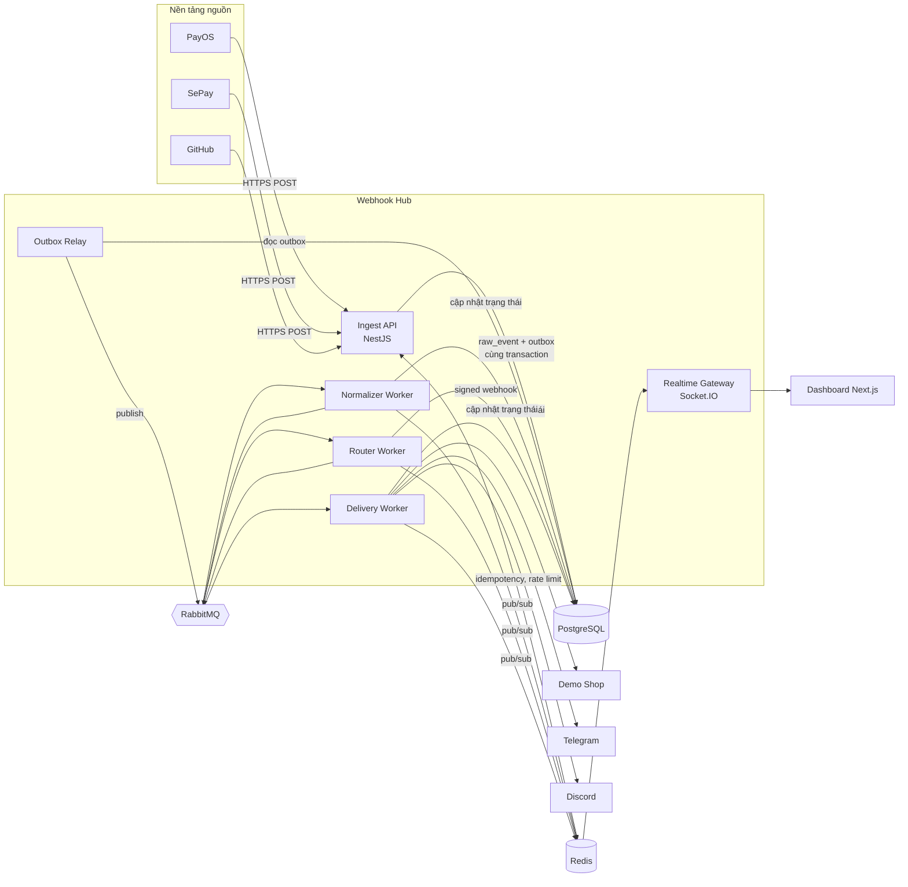
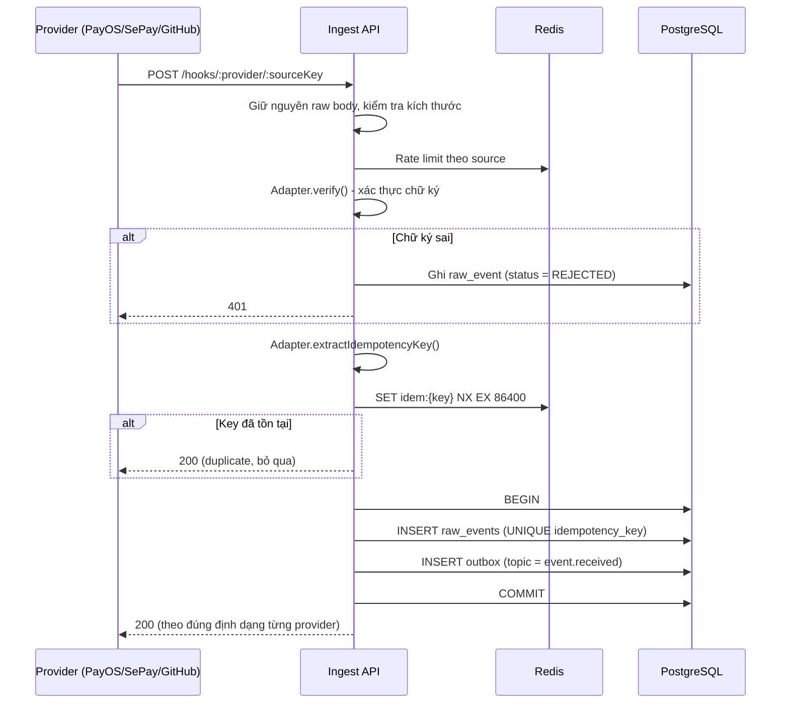
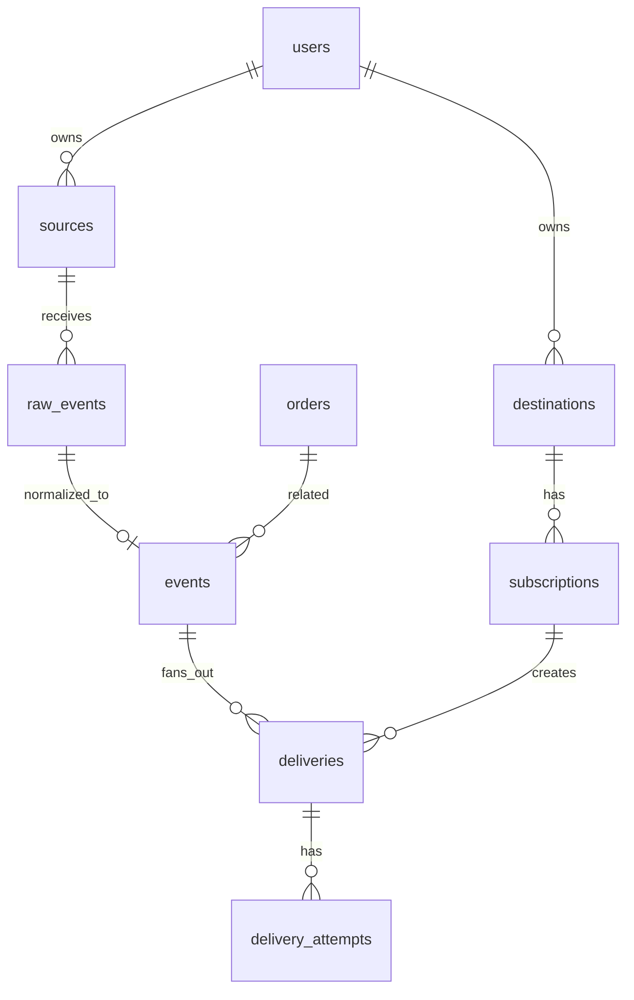

# WEBHOOK HUB
### Ứng dụng Webhook kết nối dữ liệu giữa các nền tảng mạng

> **Tài liệu ý tưởng & thiết kế tổng quan cho đồ án**
> Backend: NestJS · PostgreSQL · Redis · RabbitMQ · WebSocket (Socket.IO)
> Frontend: Next.js (Dashboard + Demo Shop mô phỏng)

---

## Mục lục

1. [Tổng quan đề tài](#1-tổng-quan-đề-tài)
2. [Phạm vi: làm gì và KHÔNG làm gì](#2-phạm-vi-làm-gì-và-không-làm-gì)
3. [Các nền tảng bên thứ ba](#3-các-nền-tảng-bên-thứ-ba)
4. [Kiến trúc hệ thống](#4-kiến-trúc-hệ-thống)
5. [Vai trò của từng công nghệ](#5-vai-trò-của-từng-công-nghệ)
6. [Luồng xử lý chi tiết](#6-luồng-xử-lý-chi-tiết)
7. [Các cơ chế đảm bảo độ tin cậy](#7-các-cơ-chế-đảm-bảo-độ-tin-cậy)
8. [Bảo mật](#8-bảo-mật)
9. [Thiết kế cơ sở dữ liệu](#9-thiết-kế-cơ-sở-dữ-liệu)
10. [Cấu trúc dự án](#10-cấu-trúc-dự-án)
11. [Frontend](#11-frontend)
12. [Kịch bản demo khi bảo vệ](#12-kịch-bản-demo-khi-bảo-vệ)
13. [Kiểm thử & đánh giá](#13-kiểm-thử--đánh-giá)
14. [Kế hoạch triển khai](#14-kế-hoạch-triển-khai)
15. [Câu hỏi hội đồng có thể hỏi](#15-câu-hỏi-hội-đồng-có-thể-hỏi)

---

## 1. Tổng quan đề tài

### 1.1. Vấn đề

Mỗi nền tảng (cổng thanh toán, ngân hàng, GitHub...) gửi webhook theo **định dạng riêng**, **cách xác thực riêng** và **cơ chế gửi lại riêng**. Nếu mỗi ứng dụng tự tích hợp trực tiếp với từng nền tảng thì:

- Code tích hợp bị lặp lại, khó bảo trì.
- Khi ứng dụng đích bị sập, webhook bị mất hoặc bị xử lý trùng.
- Không có nơi tập trung để theo dõi, kiểm tra và phát lại sự kiện.

### 1.2. Giải pháp

**Webhook Hub** là một trạm trung chuyển đứng giữa các nền tảng:

```
  Nguồn (Inbound)            WEBHOOK HUB                    Đích (Outbound)
 ┌──────────────┐     ┌───────────────────────────┐     ┌──────────────────────┐
 │ PayOS        │────▶│ 1. Xác thực chữ ký        │────▶│ Demo Shop (webhook)  │
 │ SePay        │────▶│ 2. Lưu bản gốc            │────▶│ Telegram Bot         │
 │ GitHub       │────▶│ 3. Chống trùng lặp        │────▶│ Discord              │
 └──────────────┘     │ 4. Chuẩn hóa sự kiện      │     └──────────────────────┘
                      │ 5. Định tuyến & phân phối │
                      │ 6. Retry / DLQ / Replay   │
                      │ 7. Đẩy realtime dashboard │
                      └───────────────────────────┘
```

**Nhận** webhook từ nhiều nguồn → **chuẩn hóa** về một định dạng sự kiện chung → **phân phối** đến nhiều đích một cách **tin cậy**.

### 1.3. Triết lý thiết kế

> **"Bề ngoài nhỏ gọn, bên trong chặt chẽ."**

- Giao diện chỉ là dashboard quản trị và một shop mô phỏng tối giản.
- Toàn bộ giá trị nằm ở backend: không mất sự kiện, không xử lý trùng, chịu lỗi, mở rộng được, quan sát được.

---

## 2. Phạm vi: làm gì và KHÔNG làm gì

| ✅ Làm (trọng tâm) | ❌ Không làm (tránh lệch đề) |
|---|---|
| Nhận & xác thực webhook từ 3 nguồn | Website bán hàng đầy đủ (giỏ hàng, khuyến mãi, quản lý kho) |
| Chuẩn hóa sự kiện theo schema chung | Hệ thống đăng ký/phân quyền phức tạp nhiều vai trò |
| Hàng đợi, retry, dead letter queue, replay | Kéo thả workflow kiểu Zapier/n8n |
| Chống trùng lặp (idempotency) | Hỗ trợ hàng chục nền tảng |
| Outbound webhook có ký HMAC | Ứng dụng mobile |
| Dashboard realtime | |
| Đối soát (reconciliation) với PayOS | |
| Demo Shop 3 trang để minh họa | |

**Tỷ lệ công sức dự kiến:** Backend Hub ~60% · Dashboard ~25% · Demo Shop ~15%.

---

## 3. Các nền tảng bên thứ ba

### 3.1. Tổng hợp lựa chọn

| # | Nền tảng | Môi trường | Loại sự kiện | Cách xác thực | Lựa chọn |
|---|---|---|---|---|---|
| 1 | **PayOS** | Production (đã có key) | Thanh toán thành công | Checksum HMAC-SHA256 trên trường `data` | Bắt buộc |
| 2 | **SePay** | Test Mode (sandbox) | Biến động số dư ngân hàng | Header `Authorization: Apikey ...` | **Chọn chính** |
| 2' | VNPAY | Sandbox | IPN thanh toán | HMAC-SHA512 trên query string | Mở rộng (nếu còn thời gian) |
| 3 | **GitHub** | Thật (miễn phí) | push, pull_request, issues... | Header `X-Hub-Signature-256` (HMAC-SHA256) | **Chọn chính** |
| 3' | Gmail | Google Cloud Pub/Sub push | Có email mới | OIDC token của Google | Mở rộng (phức tạp hơn) |

**Lý do chọn SePay thay vì VNPAY làm nguồn chính:** SePay có Test Mode cho phép *mô phỏng giao dịch ngân hàng bằng một nút bấm* và bắn webhook y như thật. Khi demo không cần thẻ test, không cần qua trang thanh toán, rất chủ động.

**Lý do chọn GitHub thay vì Gmail:** GitHub hỗ trợ webhook gốc, cấu hình trong 1 phút, có chữ ký HMAC chuẩn và trang "Recent Deliveries" để gửi lại. Gmail không có webhook trực tiếp, phải đi qua Google Cloud Pub/Sub, tốn thời gian cấu hình.

→ Ba nguồn với **ba cơ chế xác thực khác nhau** là chất liệu tốt để trình bày phần bảo mật.

### 3.2. PayOS (production)

- **Cấu hình:** dùng SDK `@payos/node` với `clientId`, `apiKey`, `checksumKey`. Đăng ký URL webhook qua SDK/API xác nhận webhook (khi xác nhận, PayOS có thể gửi một request kiểm tra, hub phải phản hồi 200).
- **Payload chính:** `code`, `desc`, `success`, `data` (gồm `orderCode`, `amount`, `description`, `reference`, `transactionDateTime`, `paymentLinkId`, ...), `signature`.
- **Xác thực:** dùng `payOS.webhooks.verify(body)` của SDK (bên trong: sắp xếp key của `data` theo alphabet, nối `key=value&...`, HMAC-SHA256 với `checksumKey`, so sánh với `signature`).
- **Khóa chống trùng:** `payos:{orderCode}:{reference}`.
- **Test an toàn:** tạo link thanh toán 2.000đ, tự chuyển khoản vào tài khoản của mình.
- **Đối soát:** định kỳ gọi API lấy thông tin link thanh toán cho các đơn còn `PENDING` quá lâu (phòng trường hợp webhook bị lỡ).

### 3.3. SePay (Test Mode)

- **Cấu hình:** bật Test Mode trên dashboard SePay → tạo tài khoản ngân hàng test → tạo webhook trỏ về `https://<domain>/hooks/sepay/<sourceKey>`, chọn chứng thực API Key.
- **Payload chính:** `id`, `gateway`, `transactionDate`, `accountNumber`, `code`, `content`, `transferType` (`in`/`out`), `transferAmount`, `accumulated`, `referenceCode`, `description`.
- **Xác thực:** so sánh header `Authorization: Apikey <key>` bằng `timingSafeEqual`.
- **Phản hồi thành công:** HTTP 200/201 kèm `{"success": true}`. Nếu không, SePay sẽ gửi lại.
- **Khóa chống trùng:** `sepay:{id}`.
- **Khớp đơn hàng:** trích mã đơn từ `content` bằng regex (vd: `DH\d+`), kiểm tra `transferAmount` với số tiền đơn.

### 3.4. GitHub

- **Cấu hình:** Repository → Settings → Webhooks → Payload URL `https://<domain>/hooks/github/<sourceKey>`, content type `application/json`, đặt `secret`.
- **Header quan trọng:** `X-GitHub-Event` (loại sự kiện), `X-GitHub-Delivery` (GUID duy nhất), `X-Hub-Signature-256`.
- **Xác thực:** `sha256=` + HMAC-SHA256(**raw body**, secret), so sánh bằng `timingSafeEqual`.
- **Khóa chống trùng:** `github:{X-GitHub-Delivery}`.
- **Lưu ý:** GitHub yêu cầu phản hồi nhanh (trong khoảng 10 giây) → hub phải ACK ngay, xử lý bất đồng bộ.

### 3.5. Đích (Destinations)

| Đích | Cách gửi | Ghi chú |
|---|---|---|
| **Demo Shop** | Outbound webhook có ký HMAC | Chứng minh hub cũng là *nhà cung cấp* webhook |
| **Telegram Bot** | `sendMessage` Bot API | Miễn phí, tạo bot qua BotFather |
| **Discord** | Discord Webhook URL | Miễn phí, tạo trong cài đặt kênh |

---

## 4. Kiến trúc hệ thống

### 4.1. Sơ đồ tổng thể



### 4.2. Tách tiến trình (process)

| Tiến trình | Nhiệm vụ | Có thể scale ngang? |
|---|---|---|
| `api` | Nhận webhook, REST API cho dashboard, Socket.IO gateway | Có (Socket.IO dùng Redis adapter) |
| `worker` | Consume RabbitMQ: chuẩn hóa, định tuyến, gửi đi | Có (nhiều consumer cùng queue) |
| `scheduler` | Outbox relay, đối soát PayOS, dọn dữ liệu cũ | Chạy 1 instance (dùng Redis lock) |

→ Việc tách `api` và `worker` là điểm quan trọng để chứng minh **khả năng mở rộng**: khi tải tăng, chỉ cần tăng số worker.

---

## 5. Vai trò của từng công nghệ

> Hội đồng rất hay hỏi: *"Tại sao dùng cả Redis lẫn RabbitMQ?"* → Mỗi công nghệ có vai trò riêng, không trùng lặp.

| Công nghệ | Vai trò trong hệ thống |
|---|---|
| **PostgreSQL** | Nguồn sự thật (source of truth): lưu raw event, event chuẩn hóa, delivery, outbox. Ràng buộc `UNIQUE` là lớp chống trùng cuối cùng. Dùng `JSONB` để lưu payload linh hoạt. |
| **RabbitMQ** | Message broker: truyền sự kiện giữa các bước xử lý, fan-out đến nhiều đích, **retry có độ trễ** (TTL + Dead Letter Exchange), **Dead Letter Queue**, xác nhận thủ công (manual ack) để không mất message khi worker chết. |
| **Redis** | Bộ nhớ nhanh: chống trùng lớp 1 (`SET NX`), rate limit, circuit breaker, distributed lock cho scheduler, pub/sub cho Socket.IO adapter, cache cấu hình nguồn/đích, bộ đếm thống kê realtime. |
| **WebSocket (Socket.IO)** | Đẩy sự kiện mới, trạng thái delivery, số liệu thống kê lên dashboard và cập nhật trạng thái đơn trên Demo Shop theo thời gian thực. |
| **NestJS** | Kiến trúc module, Dependency Injection, Guard (xác thực chữ ký), Interceptor (logging, correlation id), `@nestjs/microservices` hoặc `@golevelup/nestjs-rabbitmq`. |
| **Next.js** | Dashboard quản trị + Demo Shop. |
| **Docker Compose** | Chạy toàn bộ hệ thống bằng một lệnh. |

---

## 6. Luồng xử lý chi tiết

### 6.1. Luồng tổng quát: 4 giai đoạn

```
[1] INGEST ──▶ [2] NORMALIZE ──▶ [3] ROUTE ──▶ [4] DELIVER
  (api)          (worker)          (worker)       (worker)
```

### 6.2. Giai đoạn 1: Ingest (nhận webhook), phải cực nhanh



**Nguyên tắc:** Ingest **không** gọi bất kỳ dịch vụ bên ngoài nào. Chỉ xác thực → lưu → trả lời. Mục tiêu độ trễ p95 < 100ms.

### 6.3. Giai đoạn 2: Normalize (chuẩn hóa)

Mỗi adapter chuyển payload gốc thành **sự kiện chuẩn** (lấy cảm hứng từ chuẩn CloudEvents):

```json
{
  "id": "evt_01J9ZK...",
  "type": "payment.succeeded",
  "source": "payos",
  "sourceId": "src_payos_main",
  "subject": "order:DH10234",
  "occurredAt": "2026-09-16T10:20:30+07:00",
  "receivedAt": "2026-09-16T10:20:31+07:00",
  "data": {
    "orderCode": "DH10234",
    "amount": 2000,
    "currency": "VND",
    "reference": "FT2426...",
    "description": "DH10234 thanh toan"
  },
  "rawEventId": "raw_01J9ZK..."
}
```

Bảng ánh xạ loại sự kiện:

| Nguồn | Sự kiện gốc | Sự kiện chuẩn |
|---|---|---|
| PayOS | `success = true` | `payment.succeeded` |
| SePay | `transferType = in` | `bank.transfer.received` |
| SePay | `transferType = out` | `bank.transfer.sent` |
| GitHub | `push` | `repo.push` |
| GitHub | `pull_request` (opened/closed) | `repo.pull_request.opened` / `.closed` |
| GitHub | `issues` | `repo.issue.*` |

**Khớp đơn hàng (Order Matcher):** với `payment.succeeded` và `bank.transfer.received`, worker tìm đơn tương ứng rồi phát thêm sự kiện nghiệp vụ:

| Điều kiện | Sự kiện phát ra |
|---|---|
| Khớp mã đơn, đúng số tiền | `order.paid` |
| Khớp mã đơn, thiếu tiền | `order.underpaid` |
| Khớp mã đơn, thừa tiền | `order.overpaid` |
| Không tìm thấy mã đơn | `payment.unmatched` (cần xử lý thủ công) |
| Đơn đã `PAID` trước đó | Bỏ qua, ghi log |

Cập nhật trạng thái đơn dùng **optimistic locking** (`UPDATE ... WHERE status = 'PENDING'`) để tránh hai nguồn cùng lúc (PayOS webhook và job đối soát) cập nhật chồng lên nhau.

### 6.4. Giai đoạn 3: Route (định tuyến)

Mỗi **subscription** gồm: đích, danh sách loại sự kiện, điều kiện lọc, template.

```json
{
  "name": "Báo thanh toán lên Telegram",
  "destinationId": "dst_telegram_team",
  "eventTypes": ["order.paid", "payment.unmatched"],
  "filter": { "data.amount": { "$gte": 1000 } },
  "template": "💰 Đơn {{data.orderCode}} đã thanh toán {{data.amount | vnd}} qua {{source}}"
}
```

Router tìm các subscription phù hợp (cache trong Redis) → tạo bản ghi `deliveries` (mỗi đích một bản ghi) → publish lên exchange `delivery`.

### 6.5. Giai đoạn 4: Deliver (gửi đi)

Delivery worker:

1. Kiểm tra **circuit breaker** của đích (Redis). Nếu đang mở → chuyển thẳng vào hàng retry.
2. Render template, gọi HTTP đến đích với timeout (vd: 5s).
3. Ghi `delivery_attempts` (status code, thời gian phản hồi, lỗi).
4. Thành công (2xx) → `SUCCEEDED`, `ack`.
5. Thất bại → tính lần thử tiếp theo → publish vào queue retry tương ứng → `ack` message cũ.
6. Vượt số lần tối đa → đưa vào **DLQ**, trạng thái `DEAD`.
7. Mỗi thay đổi trạng thái → publish qua Redis → Socket.IO đẩy lên dashboard.

---

## 7. Các cơ chế đảm bảo độ tin cậy

### 7.1. Transactional Outbox (không mất sự kiện)

**Vấn đề:** Nếu lưu DB thành công rồi mới publish RabbitMQ, mà server sập giữa hai bước → sự kiện nằm trong DB nhưng không bao giờ được xử lý.

**Giải pháp:** Ghi `raw_event` và `outbox` trong **cùng một transaction**. Outbox Relay đọc bảng `outbox` (dùng `SELECT ... FOR UPDATE SKIP LOCKED`), publish lên RabbitMQ với **publisher confirms**, sau đó đánh dấu đã gửi.

→ Đảm bảo **at-least-once delivery** (mỗi sự kiện được xử lý ít nhất một lần).

### 7.2. Idempotency 2 lớp (không xử lý trùng)

Vì at-least-once có thể sinh trùng, và provider cũng tự gửi lại:

| Lớp | Công cụ | Mục đích |
|---|---|---|
| Lớp 1 | Redis `SET key NX EX` | Chặn nhanh, không chạm DB |
| Lớp 2 | PostgreSQL `UNIQUE (source_id, idempotency_key)` | Nguồn sự thật, đúng kể cả khi Redis mất dữ liệu |
| Consumer | Bảng `processed_messages` hoặc kiểm tra trạng thái trước khi xử lý | Worker xử lý lại message cũng không gây tác dụng phụ |

→ Kết hợp at-least-once + idempotent consumer = **effectively-once**.

### 7.3. Retry với RabbitMQ (exponential backoff)

Dùng các queue trễ với TTL cố định, hết hạn thì tự động quay về queue chính qua Dead Letter Exchange:

```
delivery.main  ──fail──▶ delivery.retry.10s ──(TTL hết)──▶ delivery.main
               ──fail──▶ delivery.retry.1m  ──(TTL hết)──▶ delivery.main
               ──fail──▶ delivery.retry.5m  ──(TTL hết)──▶ delivery.main
               ──fail──▶ delivery.retry.30m ──(TTL hết)──▶ delivery.main
               ──fail──▶ delivery.retry.2h  ──(TTL hết)──▶ delivery.main
               ──fail──▶ delivery.dlq  (DEAD – chờ xử lý thủ công)
```

- Header `x-attempt` theo dõi số lần thử.
- Thêm **jitter** (độ lệch ngẫu nhiên nhỏ) để tránh nhiều request dồn cùng một thời điểm.
- Phân loại lỗi: `4xx` (trừ 408, 429) → không retry vì lỗi cấu hình; `5xx`, timeout, lỗi mạng → retry.

### 7.4. Máy trạng thái (State Machine)

**Delivery:**
```
PENDING ──▶ DELIVERING ──▶ SUCCEEDED
                │
                └──▶ RETRYING ──▶ DELIVERING ...
                         │
                         └──▶ DEAD ──(replay thủ công)──▶ PENDING
```

**Order (Demo Shop):**
```
PENDING ──▶ PAID
   │──▶ UNDERPAID ──▶ PAID
   │──▶ EXPIRED
   └──▶ CANCELLED
```

Mọi chuyển trạng thái không hợp lệ đều bị từ chối ở tầng service.

### 7.5. Circuit Breaker

Theo dõi số lần lỗi liên tiếp của từng đích trong Redis:

- **CLOSED:** gửi bình thường.
- **OPEN:** lỗi ≥ 5 lần liên tiếp → ngừng gửi trong 60s, message chuyển sang retry.
- **HALF_OPEN:** hết 60s → cho 1 request thử; thành công thì đóng lại.

→ Tránh việc một đích bị sập làm nghẽn toàn bộ worker.

### 7.6. Đối soát (Reconciliation)

Job chạy mỗi 5 phút (có Redis lock để chỉ một instance chạy):

- Tìm đơn `PENDING` tạo quá 10 phút có link PayOS.
- Gọi API PayOS kiểm tra trạng thái thật.
- Nếu đã thanh toán mà hub chưa nhận webhook → tạo sự kiện với `origin = reconciliation` và xử lý như bình thường (idempotency đảm bảo không trùng).

→ Hệ thống **tự phục hồi** kể cả khi webhook bị mất trên đường truyền.

### 7.7. Replay

- Replay **một delivery** (gửi lại cho một đích).
- Replay **một event** (chạy lại định tuyến và gửi đến tất cả đích).
- Replay **hàng loạt** các delivery trong DLQ theo bộ lọc.

Mọi replay đều ghi `audit_logs` (ai, lúc nào, lý do).

### 7.8. Graceful shutdown

Khi tắt worker: ngừng nhận message mới → chờ các message đang xử lý xong → đóng kết nối. Message chưa `ack` sẽ được RabbitMQ trả lại queue.

---

## 8. Bảo mật

### 8.1. Bảo mật inbound

| Biện pháp | Chi tiết |
|---|---|
| Xác thực chữ ký | Mỗi adapter một cách: PayOS checksum, SePay API key, GitHub HMAC-SHA256 |
| Raw body | Cấu hình NestJS giữ `rawBody` vì HMAC phải tính trên byte gốc |
| So sánh an toàn | `crypto.timingSafeEqual` chống timing attack |
| URL khó đoán | `/hooks/:provider/:sourceKey` với `sourceKey` ngẫu nhiên |
| Giới hạn | Payload tối đa 1MB, rate limit theo source (Redis token bucket) |
| Ghi nhận request lỗi | Request sai chữ ký vẫn lưu với trạng thái `REJECTED` để điều tra |

### 8.2. Bảo mật outbound (hub ký webhook gửi đi)

Theo phong cách chuẩn Standard Webhooks:

```
X-Hub-Event-Id:   evt_01J9ZK...
X-Hub-Timestamp:  1789550431
X-Hub-Signature:  v1=<HMAC-SHA256(secret, "{id}.{timestamp}.{body}")>
```

Demo Shop khi nhận phải:
1. Kiểm tra chữ ký.
2. Từ chối nếu `timestamp` lệch quá 5 phút (**chống replay attack**).
3. Chống trùng theo `X-Hub-Event-Id`.

Hỗ trợ **xoay vòng secret** (secret rotation): trong thời gian chuyển đổi, gửi hai chữ ký `v1=...,v1=...`.

### 8.3. Bảo mật hệ thống

- Secret của nguồn/đích **mã hóa AES-256-GCM** trước khi lưu DB, khóa chính nằm trong biến môi trường.
- Dashboard đăng nhập JWT (access + refresh token).
- Che (mask) dữ liệu nhạy cảm trong log: token, số tài khoản.
- Chống SSRF khi gửi outbound: chặn URL trỏ về IP nội bộ (`127.0.0.1`, `10.x`, `192.168.x`...), trừ môi trường dev.

---

## 9. Thiết kế cơ sở dữ liệu

### 9.1. Sơ đồ quan hệ



### 9.2. Các bảng chính

**`sources`**: nguồn webhook
| Cột | Kiểu | Ghi chú |
|---|---|---|
| id | uuid PK | |
| provider | enum | `payos`, `sepay`, `github` |
| name | varchar | |
| source_key | varchar UNIQUE | Nằm trong URL |
| secret_encrypted | text | Checksum key / API key / GitHub secret |
| is_active | boolean | |
| created_at | timestamptz | |

**`raw_events`**: bản gốc, không bao giờ sửa
| Cột | Kiểu | Ghi chú |
|---|---|---|
| id | uuid PK | |
| source_id | uuid FK | |
| idempotency_key | varchar | `UNIQUE(source_id, idempotency_key)` |
| headers | jsonb | |
| body | jsonb | |
| signature_valid | boolean | |
| status | enum | `ACCEPTED`, `REJECTED`, `DUPLICATE` |
| origin | enum | `webhook`, `reconciliation`, `replay` |
| received_at | timestamptz | index |

**`events`**: sự kiện chuẩn hóa
| Cột | Kiểu | Ghi chú |
|---|---|---|
| id | uuid PK | |
| raw_event_id | uuid FK UNIQUE | |
| type | varchar | index, vd `order.paid` |
| subject | varchar | vd `order:DH10234` |
| data | jsonb | index GIN |
| occurred_at | timestamptz | |

**`destinations`**: đích
| Cột | Kiểu | Ghi chú |
|---|---|---|
| id | uuid PK | |
| type | enum | `webhook`, `telegram`, `discord` |
| config_encrypted | text | URL, bot token, chat id... |
| signing_secret_encrypted | text | Cho loại `webhook` |
| circuit_state | enum | Đồng bộ từ Redis để hiển thị |

**`subscriptions`**
| Cột | Kiểu | Ghi chú |
|---|---|---|
| id | uuid PK | |
| destination_id | uuid FK | |
| event_types | text[] | |
| filter | jsonb | |
| template | text | |
| is_active | boolean | |

**`deliveries`**
| Cột | Kiểu | Ghi chú |
|---|---|---|
| id | uuid PK | |
| event_id | uuid FK | |
| subscription_id | uuid FK | `UNIQUE(event_id, subscription_id)` |
| status | enum | `PENDING`, `DELIVERING`, `RETRYING`, `SUCCEEDED`, `DEAD` |
| attempt_count | int | |
| next_attempt_at | timestamptz | |
| last_error | text | |

**`delivery_attempts`**
| Cột | Kiểu | Ghi chú |
|---|---|---|
| id | bigserial PK | |
| delivery_id | uuid FK | |
| attempt_no | int | |
| request_body | jsonb | |
| response_status | int | |
| response_body | text | Cắt ngắn tối đa 2KB |
| duration_ms | int | |
| error | text | |
| created_at | timestamptz | |

**`outbox`**
| Cột | Kiểu | Ghi chú |
|---|---|---|
| id | bigserial PK | |
| topic | varchar | routing key |
| payload | jsonb | |
| published_at | timestamptz NULL | index partial `WHERE published_at IS NULL` |
| created_at | timestamptz | |

**`orders`** (phục vụ Demo Shop)
| Cột | Kiểu | Ghi chú |
|---|---|---|
| id | uuid PK | |
| order_code | varchar UNIQUE | vd `DH10234` |
| amount | bigint | VND |
| paid_amount | bigint | |
| status | enum | theo state machine |
| payment_provider | enum | `payos`, `sepay` |
| payos_payment_link_id | varchar | |
| version | int | optimistic locking |

**`audit_logs`**: ghi lại thao tác quản trị (replay, sửa cấu hình, xoay secret).

---

## 10. Cấu trúc dự án

```
webhook-hub/
├── apps/
│   ├── api/                      # NestJS: Ingest + REST API + Socket.IO
│   │   └── src/
│   │       ├── modules/
│   │       │   ├── auth/
│   │       │   ├── ingest/       # Controller /hooks/:provider/:sourceKey
│   │       │   ├── sources/
│   │       │   ├── destinations/
│   │       │   ├── subscriptions/
│   │       │   ├── events/       # Tra cứu, replay
│   │       │   ├── orders/       # API cho Demo Shop
│   │       │   ├── metrics/
│   │       │   └── realtime/     # Socket.IO gateway
│   │       └── main.ts
│   ├── worker/                   # NestJS: RabbitMQ consumers
│   │   └── src/
│   │       ├── normalizer/
│   │       ├── order-matcher/
│   │       ├── router/
│   │       ├── delivery/
│   │       │   └── senders/      # webhook.sender, telegram.sender, discord.sender
│   │       └── scheduler/        # outbox-relay, reconciliation, cleanup
│   └── web/                      # Next.js
│       └── app/
│           ├── (dashboard)/
│           └── demo-shop/
├── libs/
│   ├── providers/                # ⭐ Adapter pattern
│   │   ├── provider.interface.ts
│   │   ├── payos.adapter.ts
│   │   ├── sepay.adapter.ts
│   │   └── github.adapter.ts
│   ├── database/                 # Prisma/TypeORM schema, migrations
│   ├── messaging/                # Khai báo exchange, queue, retry topology
│   ├── crypto/                   # HMAC, AES-GCM, timingSafeEqual
│   └── common/                   # DTO, event schema, logger, correlation id
├── docker-compose.yml
├── k6/                           # Script test tải
└── docs/
```

### 10.1. Interface adapter (trái tim của thiết kế mở rộng)

```ts
export interface ProviderAdapter {
  readonly provider: 'payos' | 'sepay' | 'github';

  /** Xác thực request có đúng từ provider không */
  verify(req: RawWebhookRequest, secret: string): Promise<boolean>;

  /** Khóa duy nhất để chống trùng */
  extractIdempotencyKey(req: RawWebhookRequest): string;

  /** Chuyển payload gốc thành sự kiện chuẩn */
  normalize(req: RawWebhookRequest): NormalizedEvent[];

  /** Phản hồi đúng định dạng provider mong đợi */
  buildAck(result: IngestResult): { status: number; body: unknown };
}
```

→ Thêm VNPAY hoặc Gmail sau này **chỉ cần viết thêm một class**, không sửa code lõi (nguyên tắc Open/Closed).

### 10.2. Docker Compose

| Service | Image | Cổng |
|---|---|---|
| postgres | `postgres:16` | 5432 |
| redis | `redis:7` | 6379 |
| rabbitmq | `rabbitmq:3-management` | 5672, 15672 (UI quản trị) |
| api | build `apps/api` | 4000 |
| worker | build `apps/worker` (scale được: `--scale worker=3`) | |
| web | build `apps/web` | 3000 |
| tunnel | `cloudflared` hoặc ngrok | Public URL cho provider gọi vào |

---

## 11. Frontend

### 11.1. Dashboard (phần chính)

| Trang | Nội dung |
|---|---|
| **Overview** | Số sự kiện/phút, tỷ lệ thành công, độ trễ trung bình, biểu đồ theo thời gian, trạng thái circuit của các đích. Cập nhật realtime. |
| **Live Events** | Dòng sự kiện chảy liên tục như terminal, lọc theo nguồn/loại/trạng thái. |
| **Event Detail** | Tab *Raw* (headers + body gốc), tab *Normalized*, tab *Deliveries* (timeline từng lần thử, status code, thời gian), nút **Replay**. |
| **Sources** | Danh sách nguồn, URL webhook (nút copy), nút xoay secret, trạng thái nhận gần nhất. |
| **Destinations & Subscriptions** | Tạo đích, cấu hình loại sự kiện, bộ lọc, template, nút **Gửi thử**. |
| **Dead Letter Queue** | Danh sách delivery thất bại, lý do, replay đơn lẻ hoặc hàng loạt. |
| **Unmatched Payments** | Giao dịch không khớp đơn, cho phép gán tay vào đơn. |

**Sự kiện Socket.IO:**
```
event.received       # có webhook mới
event.normalized     # đã chuẩn hóa
delivery.updated     # delivery đổi trạng thái
order.updated        # đơn hàng đổi trạng thái (Demo Shop nghe)
metrics.tick         # số liệu mỗi 2 giây
circuit.changed      # circuit breaker đổi trạng thái
```

Dùng **room** theo người dùng/đơn hàng để chỉ đẩy dữ liệu đúng người cần.

### 11.2. Demo Shop (tối giản, 3 trang)

1. **Sản phẩm:** 3–4 sản phẩm cố định (giá 2.000đ – 10.000đ).
2. **Thanh toán:** chọn PayOS (hiện QR/link thật) hoặc SePay (hiện QR + mã đơn; trong demo bấm "Mô phỏng" ở dashboard SePay).
3. **Trạng thái đơn:** tự đổi từ "Chờ thanh toán" sang "Đã thanh toán" qua WebSocket, kèm hiệu ứng.

Demo Shop **nhận outbound webhook** từ hub tại `/api/hub-webhook`, có kiểm tra chữ ký, để chứng minh luồng hai chiều.

---

## 12. Kịch bản demo khi bảo vệ

| # | Kịch bản | Điều chứng minh |
|---|---|---|
| 1 | Mua hàng bằng **PayOS thật** (2.000đ) → đơn tự chuyển "Đã thanh toán", Telegram báo, dashboard hiện sự kiện | Luồng end-to-end thật |
| 2 | **SePay Test Mode** mô phỏng chuyển khoản có mã đơn → đơn được thanh toán | Webhook ngân hàng, khớp đơn |
| 3 | SePay mô phỏng **chuyển thiếu tiền** / **sai mã đơn** → `order.underpaid` / `payment.unmatched` | Xử lý nghiệp vụ biên |
| 4 | **Push code GitHub** → Discord nhận thông báo commit | Hub đa nền tảng, không chỉ thanh toán |
| 5 | Gửi lại **cùng một webhook** nhiều lần (dùng "Redeliver" trên GitHub hoặc curl) → chỉ xử lý 1 lần | Idempotency |
| 6 | Gửi request **sai chữ ký** → bị từ chối 401, hiện trong log | Bảo mật |
| 7 | **Tắt Demo Shop** → tạo giao dịch → dashboard hiện RETRYING → bật lại → tự giao thành công | Retry, chịu lỗi |
| 8 | Để đích lỗi liên tục → **circuit breaker mở** → vào **DLQ** → bấm **Replay** | Circuit breaker, DLQ, replay |
| 9 | **Kill worker** giữa chừng → khởi động lại → message không mất | Manual ack, at-least-once |
| 10 | Chạy **k6** bắn 500 webhook/giây, mở RabbitMQ UI thấy queue tăng rồi giảm, scale worker lên 3 | Khả năng chịu tải, mở rộng |

> Kịch bản 7 và 9 là "vũ khí" gây ấn tượng mạnh nhất vì hội đồng thấy tận mắt hệ thống tự phục hồi.

---

## 13. Kiểm thử & đánh giá

### 13.1. Các loại kiểm thử

| Loại | Công cụ | Nội dung |
|---|---|---|
| Unit test | Jest | Adapter verify/normalize, template, state machine, tính backoff |
| Integration test | Jest + Testcontainers | Ingest → DB → RabbitMQ với Postgres/Redis/RabbitMQ thật |
| E2E test | Supertest | Gửi webhook mẫu có chữ ký, kiểm tra kết quả cuối |
| Load test | k6 | Thông lượng, độ trễ |
| Chaos test | Script thủ công | Tắt worker, tắt đích, tắt Redis |

### 13.2. Chỉ số đánh giá (đưa vào báo cáo)

| Chỉ số | Mục tiêu đề xuất |
|---|---|
| Độ trễ ingest p95 | < 100ms |
| Độ trễ end-to-end (nhận → giao thành công) p95 | < 1s khi đích hoạt động bình thường |
| Thông lượng ingest | ≥ 500 request/giây trên máy cá nhân |
| Tỷ lệ mất sự kiện khi kill worker | 0% |
| Tỷ lệ xử lý trùng khi gửi lặp | 0% |
| Thời gian phục hồi sau khi đích hoạt động lại | Theo lịch retry |

> Đây là **mục tiêu**, số liệu thật cần đo và ghi lại trong báo cáo kèm cấu hình máy.

### 13.3. Quan sát hệ thống (Observability)

- **Correlation ID** gắn từ lúc nhận webhook, đi theo message qua mọi worker → tra được toàn bộ hành trình một sự kiện.
- Log có cấu trúc (JSON) bằng `pino`.
- Endpoint `/health` kiểm tra Postgres, Redis, RabbitMQ.
- (Mở rộng) Prometheus + Grafana.

---

## 14. Kế hoạch triển khai

| Tuần | Công việc | Kết quả |
|---|---|---|
| 1 | Nghiên cứu lý thuyết, tài liệu PayOS/SePay/GitHub, dựng Docker Compose | Môi trường chạy được |
| 2 | Thiết kế DB, khởi tạo NestJS monorepo, auth | Schema + migration |
| 3 | Ingest API + 3 adapter + idempotency + outbox | Nhận & lưu webhook thật |
| 4 | RabbitMQ topology, outbox relay, normalizer | Sự kiện chuẩn hóa |
| 5 | Order matcher, router, subscription | Định tuyến hoạt động |
| 6 | Delivery worker (webhook, Telegram, Discord), retry, DLQ | Giao được đến đích |
| 7 | Circuit breaker, reconciliation, replay, mã hóa secret | Logic chặt chẽ hoàn chỉnh |
| 8 | Socket.IO gateway, Dashboard (Overview, Live Events, Detail) | Dashboard realtime |
| 9 | Dashboard còn lại + Demo Shop | Frontend hoàn chỉnh |
| 10 | Unit/integration test, k6, chaos test | Số liệu đánh giá |
| 11 | Deploy VPS, sửa lỗi, tối ưu | Bản chạy online |
| 12 | Viết báo cáo, slide, tập dượt kịch bản demo | Sẵn sàng bảo vệ |

**Mở rộng nếu còn thời gian:** VNPAY adapter · Gmail qua Pub/Sub · Google Sheets destination · Prometheus/Grafana · Transform bằng JSONata.

---

## 15. Câu hỏi hội đồng có thể hỏi

**Q1. Tại sao không xử lý luôn trong request mà phải qua hàng đợi?**
Provider yêu cầu phản hồi nhanh (GitHub khoảng 10 giây). Nếu gọi Telegram/Discord ngay trong request mà đích chậm hoặc lỗi, provider sẽ timeout và gửi lại, gây trùng. Hàng đợi tách việc *nhận* khỏi việc *xử lý*, giúp ingest luôn nhanh và scale độc lập.

**Q2. Tại sao dùng cả Redis và RabbitMQ?**
RabbitMQ đảm bảo message được giao tin cậy (ack, retry, DLQ, routing). Redis là bộ nhớ nhanh cho các việc cần độ trễ thấp: chống trùng lớp đầu, rate limit, circuit breaker, lock, pub/sub cho Socket.IO. Hai công cụ bổ trợ nhau, không thay thế nhau.

**Q3. Làm sao đảm bảo không mất sự kiện?**
Transactional Outbox + publisher confirms + manual ack + job đối soát PayOS. Mọi webhook đều được lưu bản gốc trước khi trả lời provider.

**Q4. Làm sao đảm bảo không trừ/cộng tiền hai lần?**
Idempotency hai lớp (Redis + UNIQUE trong PostgreSQL), unique `(event_id, subscription_id)` cho delivery, optimistic locking khi cập nhật đơn.

**Q5. Nếu Redis bị sập?**
Lớp chống trùng cuối cùng nằm ở PostgreSQL nên vẫn đúng. Rate limit và circuit breaker chuyển sang chế độ "cho qua" (fail-open) và ghi cảnh báo.

**Q6. Hệ thống khác gì Zapier/n8n?**
Đề tài tập trung vào **độ tin cậy của tầng webhook** (xác thực, chống trùng, retry, DLQ, đối soát, quan sát) cho các nền tảng Việt Nam như PayOS, SePay, thay vì trình dựng workflow kéo thả.

**Q7. Muốn thêm nền tảng mới thì sao?**
Viết một class implement `ProviderAdapter` và đăng ký vào registry. Không cần sửa ingest, worker hay DB.

---

## Phụ lục: Tài liệu tham khảo

- PayOS Docs: https://payos.vn/docs
- SePay Developer: https://developer.sepay.vn
- SePay Test Mode: https://docs.sepay.vn/test-mode.html
- GitHub Webhooks: https://docs.github.com/en/webhooks
- VNPAY Sandbox (mở rộng): https://sandbox.vnpayment.vn
- Standard Webhooks: https://www.standardwebhooks.com
- CloudEvents: https://cloudevents.io
- RabbitMQ Dead Letter Exchanges: https://www.rabbitmq.com/docs/dlx
- Transactional Outbox Pattern: https://microservices.io/patterns/data/transactional-outbox.html
